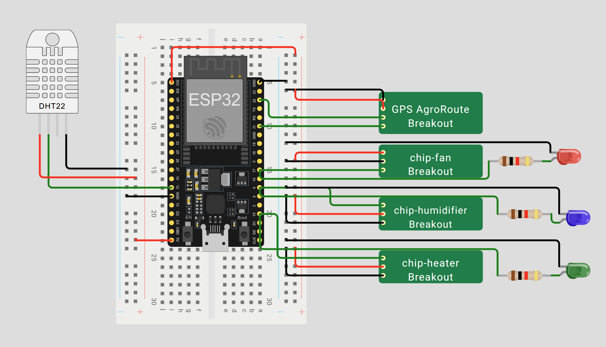

# AgroRoute IoT Demo

<p align="center">
  
</p>

Este proyecto simula un dispositivo IoT que:

* Mide temperatura y humedad con un **DHT22**.
* Simula datos de ubicación GPS mediante un **custom‑chip** (`gps-agroroute`).
* Controla y simula actuadores: **ventilador**, **humidificador** y **calefactor**, cada uno con su propio LED indicador.
* Publica un JSON con los datos de sensores a un endpoint REST.

## 📎 Enlace al proyecto Wokwi

[Ver y editar en Wokwi](https://wokwi.com/projects/430893166627987457)

## 🗂 Estructura de archivos

```
├── diagram.json                      # Configuración de la simulación (ESP32, DHT22, chips, LEDs)
├── libraries.txt                     # Bibliotecas necesarias para Wokwi (WiFi, HTTPClient, ArduinoJson, PubSubClient, DHT)
│
├── gps-agroroute.chip.json/.c        # GPS custom‑chip que emite NMEA GPGGA simulada
├── chip-fan.chip.json/.c             # Custom‑chip que imprime estado del ventilador
├── chip-humidifier.chip.json/.c      # Custom‑chip que imprime estado del humidificador
├── chip-heater.chip.json/.c          # Custom‑chip que imprime estado del calefactor
│
├── sensors.h / sensors.cpp           # Lectura de DHT22 (temperatura y humedad)
├── network.h / network.cpp           # Módulo de red: Wi‑Fi, HTTP POST, MQTT SUBSCRIBE
├── agroroute.ino                     # Sketch principal: orquesta sensores, GPS, red y actuadores
│
└── resources/images/demo.png         # Captura de pantalla de la simulación
```

## 🔌 Cableado y LEDs indicadores

* **DHT22** conectado a GPIO 12 (SDA), 3V3 y GND.
* **GPS** (TX→GPIO 21, RX→GPIO 22).
* **Ventilador (fan)** controlado por GPIO 17 + LED azul con resistencia 220 Ω a GND.
* **Humidificador** controlado por GPIO 4 + LED verde con resistencia 220 Ω a GND.
* **Calefactor** controlado por GPIO 15 + LED rojo con resistencia 220 Ω a GND.

> Los LEDs se encienden cuando se activa el actuador (pin HIGH) y se apagan cuando se desactiva (pin LOW).

## ▶️ Instrucciones para ejecutar

1. Abre el proyecto en Wokwi con el enlace de arriba.
2. Pulsa **Run**.
3. Abre el **Serial Monitor** a **115200 bps**.
4. Observa:

   * Conexión Wi‑Fi y dirección IP.
   * Suscripción MQTT a `agroroute/{device_id}/#`.
   * Envío HTTP cada 5 s de telemetría (temperature, humidity, latitude, longitude).
   * Recepción instantánea de comandos MQTT `fan`, `heater`, `humidifier` con logs y LEDs.

## 📤 Payload enviado al endpoint (cada 5 s)

```json
{
  "device_id": "agro-route-001",
  "temperature": 24.3,
  "humidity": 50.1,
  "latitude": -12.0464,
  "longitude": -77.0428,
  "created_at": "2025-06-18T20:04:35.998179Z"
}
```

## 🔄 Flujo completo de datos

1. **ESP32** lee DHT22 y GPS, envía telemetría por HTTP al Edge Service.
2. **Edge Service** (FastAPI) guarda localmente, dispara lógica de control (DDD), publica comandos MQTT.
3. **ESP32** recibe vía MQTT y activa/desactiva pines de los actuadores y enciende LEDs.

## ⚙️ Personalización

* Cambia pines del DHT22, GPS o actuadores en `agroroute.ino` para otro cableado.
* Ajusta umbrales de temperatura/humedad en `control/domain/services.py`.
* Modifica `ENDPOINT_MONITORING` en `network.cpp` para tu API real.
* Para enviar datos a la nube, configura la variable `CLOUD_MONITORING_ENDPOINT` en un `.env` y usa el adapter `CloudMonitoringClient`.

---

© 2025 AgroRoute
